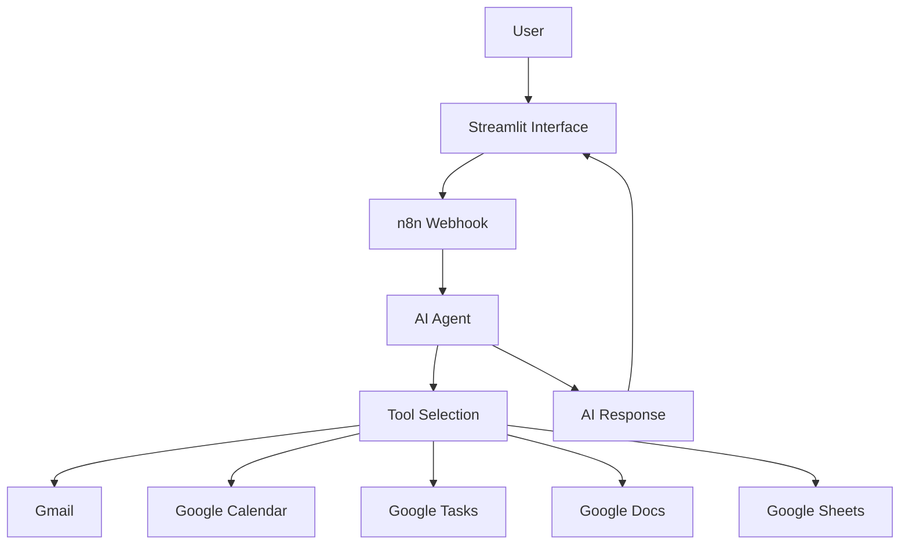

# 🤖 Sidd AI – Personal AI Assistant

An AI-powered personal assistant built using **Streamlit, n8n, and AI Agents**. Sidd AI helps automate everyday tasks through natural language conversations.

## ✨ Features

- 🧠 AI-powered question answering
- 📅 Google Calendar event management
- 📧 Gmail reading and email automation
- ✅ Google Tasks management
- 📝 Google Docs-based notes management
- 💰 Expense tracking using Google Sheets
- 🧮 Mathematical calculations
- 🔎 Google Search integration

*Feature availability depends on the connected n8n workflow and configured integrations.*

## 🛠️ Tech Stack

| Technology | Purpose |
|---|---|
| Python | Application logic |
| Streamlit | Interactive web interface |
| n8n | Workflow automation |
| AI Agent | Natural language processing |
| Google APIs | Productivity integrations |
| Requests | Webhook communication |

## 🏗️ Architecture



## 📂 Project Structure

```text
Sidd-AI-Personal-Assistant/
│
├── app.py
├── sysprompt.md
├── test_webhook.py
├── requirements.txt
├── README.md
└── .gitignore
```

## ⚙️ Installation

### 1. Clone the repository

```bash
git clone https://github.com/siddhant754962/Sidd-AI-Personal-Assistant.git
cd Sidd-AI-Personal-Assistant
```

### 2. Create virtual environment

```bash
python -m venv venv
```

### 3. Activate environment

Windows:

```bash
venv\Scripts\activate
```

### 4. Install dependencies

```bash
python -m pip install -r requirements.txt
```

### 5. Configure n8n webhook

Create `.streamlit/secrets.toml`:

```toml
N8N_WEBHOOK_URL = "YOUR_PRIVATE_N8N_WEBHOOK_URL"
```

Never upload this file to GitHub.

### 6. Run application

```bash
python -m streamlit run app.py
```

## 🔗 GitHub Repository

https://github.com/siddhant754962/Sidd-AI-Personal-Assistant

## 👨‍💻 Developer

**Siddhant Kumar Patel**

GitHub: https://github.com/siddhant754962

LinkedIn: https://www.linkedin.com/in/siddhnat-kumar-patel-699b8a251

---

Built with ❤️ using Python, Streamlit and n8n.
